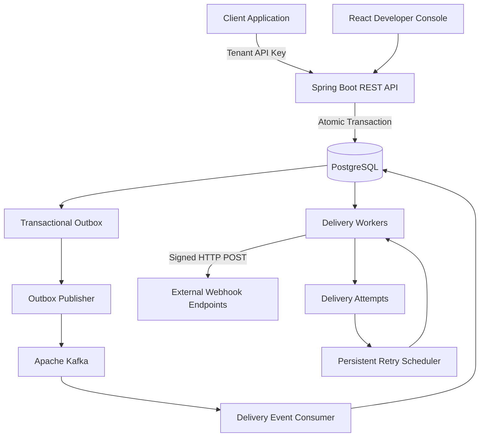

# HookForge

### Distributed Webhook Delivery Infrastructure

**A multi-tenant, event-driven webhook delivery platform built with Java, Spring Boot, Apache Kafka, and PostgreSQL.**

HookForge enables applications to reliably deliver event-driven HTTP notifications to external systems through durable event ingestion, asynchronous processing, persistent retries, cryptographic request signing, and failure recovery.

Instead of making applications manage webhook delivery, retry scheduling, and delivery history themselves, HookForge provides a centralized infrastructure layer designed to handle unreliable external endpoints and asynchronous workloads.

**[Live Demo](https://hook-forge-oq0xewo00-nisat-s-projects.vercel.app/) · [Backend API](https://hookforge-backend-xkzt.onrender.com/) · [GitHub Repository](https://github.com/nisatsama/HookForge)**

---

## Architecture

HookForge follows an event-driven architecture built around PostgreSQL as the source of truth and Apache Kafka as the asynchronous messaging layer.



### Core Engineering Concepts

- **Transactional Outbox Pattern:** Persists application events and corresponding outbox records within the same database transaction, preventing accepted events from being lost during broker publication failures.
- **Asynchronous Event Processing:** Uses Apache Kafka to decouple event ingestion from downstream delivery processing.
- **Multi-Tenant Isolation:** Scopes API authentication, endpoints, events, deliveries, and operational queries to individual tenants.
- **Persistent Delivery State:** Uses PostgreSQL to maintain delivery status, processing ownership, retry schedules, and attempt history.
- **Failure Recovery:** Recovers abandoned processing work and supports persistent retries and manual replay.
- **Cryptographic Request Signing:** Signs outgoing webhook requests using HMAC-based signatures.
- **Secret Protection:** Encrypts stored endpoint signing secrets using AES-GCM.

## Key Features

### 1. Multi-Tenant API Authentication
- Tenant-scoped API-key authentication.
- Hashed API-key storage and revocation support.
- Tenant-aware authorization across protected resources.
- Rate limiting for API requests.

### 2. Event Ingestion and Routing
- REST-based event ingestion.
- Idempotency-key support to prevent duplicate logical event creation.
- Request-payload conflict detection for reused idempotency keys.
- Endpoint subscriptions based on event types.
- Durable event persistence using PostgreSQL.

### 3. Event-Driven Processing
- Transactional outbox for reliable event publication.
- Kafka-based asynchronous event distribution.
- Consumer-side duplicate tolerance.
- Separation of event ingestion and outbound HTTP delivery.

### 4. Reliable Webhook Delivery
- Asynchronous HTTP delivery workers.
- Endpoint-specific delivery records.
- Persistent delivery status and attempt history.
- Connection and response timeouts.
- Processing ownership using database-backed claims and processing tokens.
- Recovery of abandoned processing work.

### 5. Retry and Replay
- Persistent retry scheduling.
- Automatic handling of retryable failures.
- Configurable retry-related processing policies.
- Manual replay of eligible deliveries.
- Delivery history for debugging failed requests.

### 6. Webhook Security
- HMAC-based outgoing request signatures.
- AES-GCM encryption for endpoint secrets.
- Tenant-scoped API authentication.
- Destination validation to mitigate SSRF risks.
- Rate limiting and bounded outbound request handling.

### 7. Developer Console
- React and TypeScript dashboard.
- Endpoint management.
- Event and delivery inspection.
- Delivery attempt visibility.
- Operational metrics.
- Public read-only demo mode for exploring the platform without API credentials.

---

## Delivery Lifecycle

A typical event moves through the following stages:

1. **Event Ingestion:** A client submits an event through the REST API using its tenant API key and an idempotency key.
2. **Atomic Persistence:** HookForge stores the event and its corresponding outbox record in one PostgreSQL transaction.
3. **Broker Publication:** The outbox publisher forwards pending events to Apache Kafka.
4. **Delivery Creation:** The consumer identifies subscribed endpoints and creates endpoint-specific delivery records.
5. **Delivery Claiming:** Workers claim eligible deliveries while preventing concurrent ownership.
6. **HTTP Dispatch:** Workers send signed HTTP POST requests to registered endpoints.
7. **Outcome Recording:** HookForge records the HTTP response, execution duration, and delivery outcome.
8. **Retry and Recovery:** Retryable failures are rescheduled, while abandoned processing work can be recovered.
9. **Operational Inspection:** Developers inspect delivery history and manually replay eligible failures.

**Delivery semantics:** HookForge is designed around at-least-once processing. Duplicate publication or ambiguous HTTP outcomes can result in repeated delivery attempts. Consumers should use stable event identifiers to implement their own deduplication.

---

## Technology Stack

| Layer | Technologies |
|---|---|
| Language | Java 21 |
| Backend | Spring Boot |
| Security | Spring Security |
| API | REST, Bean Validation |
| Messaging | Apache Kafka |
| Database | PostgreSQL |
| Database Migrations | Flyway |
| Persistence | Spring Data JPA, Hibernate |
| Authentication | Tenant API Keys |
| Cryptography | HMAC-SHA256, AES-GCM |
| Frontend | React, TypeScript |
| Styling | Tailwind CSS |
| Testing | JUnit 5, Mockito, Testcontainers |
| Infrastructure | Docker, Docker Compose |
| Deployment | Render, Vercel |

---

## Live Demo

**Explore HookForge without creating an account.**

The public demo provides a read-only view of pre-provisioned sample data, allowing developers and reviewers to explore the dashboard and understand the delivery workflow.

[Open HookForge Live Demo](https://hook-forge-oq0xewo00-nisat-s-projects.vercel.app/)

### Demo Architecture and Isolation

- The public demo uses dedicated `/api/v1/demo/**` backend endpoints.
- Demo data belongs to a separately configured demo tenant.
- Demo requests cannot access authenticated tenant resources.
- The demo is read-only and does not trigger actual webhook delivery.
- Demo fixtures are excluded from normal event ingestion, Kafka routing, delivery claims, and recovery processing.
- Public demo endpoints are rate-limited.

The authenticated application remains available through the login interface for API-key-based access.

---

## Getting Started

### Prerequisites

- Java 21
- Node.js 22.12+
- Docker Desktop with Docker Compose
- PowerShell (for the commands below)

### 1. Clone the Repository

```powershell
git clone https://github.com/nisatsama/HookForge.git
cd HookForge
```

### 2. Configure Environment Variables

HookForge requires a 32-byte AES encryption key for protecting endpoint signing secrets.

Generate one using PowerShell:

```powershell
$env:HOOKFORGE_ENCRYPTION_KEY = [Convert]::ToBase64String(
    [Security.Cryptography.RandomNumberGenerator]::GetBytes(32)
)
```

Keep the generated key secure. Never commit encryption keys, API keys, database credentials, or other secrets to version control.

Configure the remaining environment variables according to the local development guide.

### 3. Start the Infrastructure and Application

From the repository root:

```powershell
docker compose -f infra/docker-compose.yml up --build
```

This starts the services configured in the Docker Compose environment.

### 4. Access the Application

| Component | URL |
|---|---|
| Frontend | http://localhost:5173 |
| Backend | http://localhost:8080 |

**Tenant provisioning:** The application requires a trusted operator provisioning path for initial tenant creation and API-key issuance. Do not expose database access or introduce an unauthenticated public bootstrap endpoint.

For detailed environment configuration and troubleshooting, see [Local Development Guide](docs/LOCAL_DEVELOPMENT.md).

---

## Running Tests

### Backend

```powershell
cd backend

./mvnw clean test
./mvnw package
```

Integration tests using Testcontainers require Docker to be available to the Java process.

### Frontend

```powershell
cd frontend

npm install
npm run build
npm run lint
npm run test
```

### Engineering Scenarios

The test suite covers important backend correctness and failure-handling scenarios, including:

- API-key authentication and tenant isolation.
- Transactional outbox consistency.
- Duplicate event handling.
- Concurrent delivery claiming.
- Delivery completion and retry behavior.
- Recovery of abandoned deliveries.
- Manual replay validation.
- Webhook signature generation and verification behavior.
- Destination security validation.
- HTTP client integration behavior.

---

## Repository Structure

```text
HookForge/
├── backend/
│   └── src/
│       ├── main/
│       │   ├── java/com/hookforge/
│       │   │   ├── common/
│       │   │   ├── delivery/
│       │   │   ├── demo/
│       │   │   ├── endpoint/
│       │   │   ├── event/
│       │   │   ├── identity/
│       │   │   ├── messaging/
│       │   │   ├── outbox/
│       │   │   ├── retry/
│       │   │   ├── security/
│       │   │   ├── tenant/
│       │   │   └── webhook/
│       │   └── resources/db/migration/
│       └── test/
├── frontend/
│   └── src/
│       ├── api/
│       ├── context/
│       ├── pages/
│       ├── routes/
│       ├── styles.css
│       └── types/
├── infra/
│   └── docker-compose.yml
├── docs/
│   ├── API_CONTRACT.md
│   ├── BACKEND_AUDIT.md
│   └── LOCAL_DEVELOPMENT.md
├── CHANGELOG.md
└── README.md
```

The backend follows a modular architecture organized around business capabilities, separating API, application, domain, and infrastructure responsibilities.

---

## Engineering Focus

HookForge explores practical distributed systems and backend infrastructure challenges:

- Maintaining consistency between database transactions and asynchronous message publication.
- Designing idempotent event ingestion and duplicate-tolerant consumers.
- Coordinating concurrent workers through database-backed processing claims.
- Recovering abandoned work after application failures.
- Implementing persistent retry and replay workflows.
- Securing multi-tenant APIs and outbound webhook requests.
- Separating authoritative database state from asynchronous message transport.
- Building observable and auditable delivery workflows.

## Documentation

| Document | Description |
|---|---|
| [API Contract](docs/API_CONTRACT.md) | REST endpoints, request formats, and response contracts |
| [Backend Audit](docs/BACKEND_AUDIT.md) | Implementation review, limitations, and outstanding risks |
| [Local Development](docs/LOCAL_DEVELOPMENT.md) | Environment configuration, setup, and troubleshooting |

---

## Project Links

- **GitHub:** https://github.com/nisatsama/HookForge
- **Live Frontend:** https://hook-forge-oq0xewo00-nisat-s-projects.vercel.app/
- **Backend Deployment:** https://hookforge-backend-xkzt.onrender.com/

---

**HookForge — Distributed Webhook Delivery Infrastructure**

*Built with Java, Spring Boot, Apache Kafka, PostgreSQL, React, and TypeScript.*
