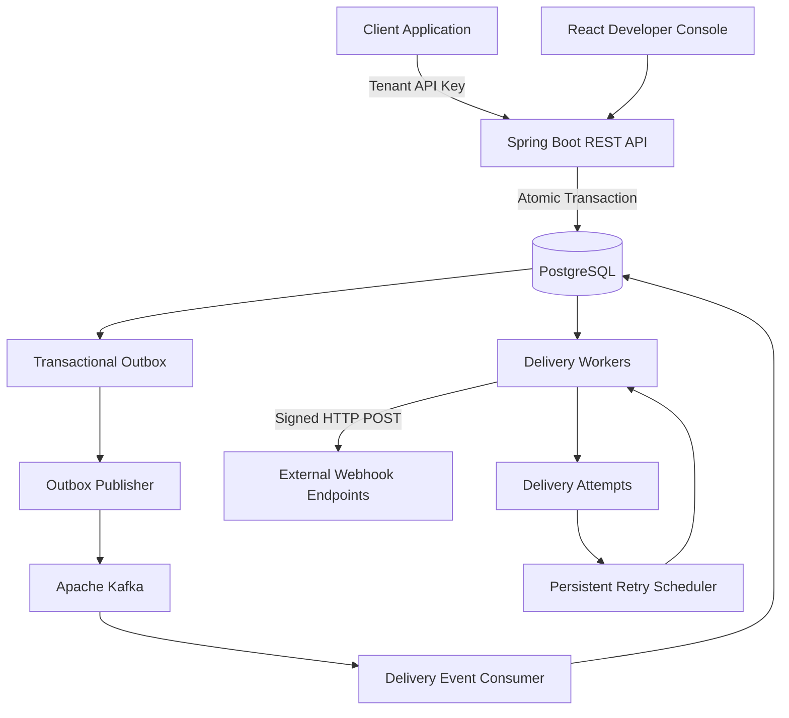

# HookForge

### Distributed Webhook Delivery Infrastructure

**A multi-tenant, event-driven webhook delivery platform built with Java 21, Spring Boot, Apache Kafka, and PostgreSQL.**

HookForge is a backend infrastructure platform that enables applications to reliably deliver event-driven HTTP notifications to external services. It combines durable event ingestion, asynchronous processing, persistent retries, cryptographic request signing, and automated failure recovery into a centralized webhook delivery system.

Rather than requiring individual applications to implement webhook scheduling, retry mechanisms, delivery tracking, and failure handling, HookForge provides a reusable infrastructure layer designed for unreliable external endpoints and distributed workloads.

**[Live Demo](https://hook-forge-oq0xewo00-nisat-s-projects.vercel.app/) · [Backend API](https://hookforge-backend-xkzt.onrender.com/) · [GitHub Repository](https://github.com/nisatsama/HookForge)**

---

## Architecture

HookForge uses an event-driven architecture with PostgreSQL as the source of truth and Apache Kafka for asynchronous message distribution.



### Architectural Principles

- **Transactional Outbox:** Persists business events and corresponding outbox records within the same database transaction, preventing accepted events from being lost during broker publication failures.
- **Asynchronous Processing:** Uses Kafka to decouple event ingestion from downstream webhook delivery.
- **Multi-Tenant Isolation:** Enforces tenant-scoped authentication, authorization, resource access, and operational queries.
- **Database-Backed Coordination:** Uses persistent delivery states and processing ownership to coordinate concurrent workers.
- **Failure Recovery:** Supports persistent retries, recovery of abandoned processing tasks, and manual replay.
- **Cryptographic Security:** Uses HMAC-based request signatures and AES-GCM encryption for endpoint signing secrets.

## Key Features

### 1. Multi-Tenant Authentication and Authorization

- Tenant-scoped API-key authentication.
- Hashed API-key storage and revocation.
- Tenant-aware authorization across protected resources.
- API rate limiting.

### 2. Event Ingestion and Routing

- REST-based event ingestion.
- Idempotency-key support to prevent duplicate logical event creation.
- Payload conflict detection when an idempotency key is reused.
- Event-type-based endpoint subscriptions.
- Durable event persistence using PostgreSQL.

### 3. Event-Driven Processing

- Transactional Outbox Pattern for reliable event publication.
- Kafka-based asynchronous event distribution.
- Duplicate-tolerant consumer processing.
- Separation of event ingestion from outbound HTTP delivery.

### 4. Reliable Webhook Delivery

- Asynchronous HTTP delivery workers.
- Endpoint-specific delivery records.
- Persistent delivery states and attempt history.
- Configurable connection and response timeouts.
- Database-backed delivery claiming and processing tokens.
- Recovery of abandoned processing work.

### 5. Retry and Replay Mechanisms

- Persistent retry scheduling.
- Automatic handling of retryable failures.
- Configurable retry-related processing policies.
- Manual replay of eligible deliveries.
- Delivery attempt history for debugging and operational inspection.

### 6. Webhook Security

- HMAC-based outgoing request signatures.
- AES-GCM encryption of endpoint signing secrets.
- Tenant-scoped API authentication.
- Destination validation to mitigate SSRF vulnerabilities.
- Rate limiting and bounded outbound HTTP request handling.

### 7. Developer Console

A React and TypeScript dashboard providing:

- Webhook endpoint management.
- Event and delivery inspection.
- Delivery attempt visibility.
- Operational metrics.
- Public read-only demo mode.

---

## Delivery Lifecycle

A typical webhook event passes through the following stages:

1. **Event Ingestion:** A client submits an event using its tenant API key and an idempotency key.
2. **Atomic Persistence:** The event and corresponding outbox record are persisted in a single PostgreSQL transaction.
3. **Broker Publication:** The outbox publisher forwards pending events to Apache Kafka.
4. **Delivery Creation:** The consumer identifies subscribed endpoints and creates endpoint-specific delivery records.
5. **Worker Coordination:** Delivery workers claim eligible records while preventing concurrent ownership.
6. **HTTP Dispatch:** Workers send signed HTTP POST requests to registered webhook endpoints.
7. **Outcome Recording:** HTTP responses, execution duration, and delivery outcomes are persisted.
8. **Retry and Recovery:** Retryable failures are rescheduled, and abandoned processing tasks can be recovered.
9. **Operational Inspection:** Developers inspect delivery history and manually replay eligible failures.

**Delivery semantics:** HookForge follows an at-least-once processing model. Duplicate publication or ambiguous HTTP outcomes can result in repeated delivery attempts. Downstream consumers should use stable event identifiers to implement deduplication.

---

## Technology Stack

| Layer | Technologies |
|---|---|
| Language | Java 21 |
| Backend | Spring Boot |
| Security | Spring Security |
| API | REST, Bean Validation |
| Messaging | Apache Kafka |
| Database | PostgreSQL |
| Database Migrations | Flyway |
| Persistence | Spring Data JPA, Hibernate |
| Authentication | Tenant API Keys |
| Cryptography | HMAC-SHA256, AES-GCM |
| Frontend | React, TypeScript |
| Styling | Tailwind CSS |
| Testing | JUnit 5, Mockito, Testcontainers |
| Infrastructure | Docker, Docker Compose |
| Deployment | Render, Vercel |

---

## Live Demo

**Explore HookForge without creating an account.**

The public demo provides a read-only interface with pre-provisioned sample data, allowing developers and reviewers to explore the dashboard and understand the webhook delivery workflow.

**[Launch HookForge Demo](https://hook-forge-oq0xewo00-nisat-s-projects.vercel.app/)**

### Demo Isolation and Security

- Dedicated `/api/v1/demo/**` backend endpoints.
- Separately configured demo tenant.
- No access to authenticated tenant resources.
- Read-only interactions without triggering actual webhook deliveries.
- Demo fixtures excluded from normal event ingestion, Kafka routing, delivery claims, and recovery processing.
- Rate-limited public demo endpoints.

The authenticated application remains accessible through the login interface for API-key-based access.

---

## Getting Started

### Prerequisites

- Java 21
- Node.js 22.12+
- Docker Desktop with Docker Compose
- PowerShell (commands below)

### 1. Clone the Repository

```powershell
git clone https://github.com/nisatsama/HookForge.git
cd HookForge
```

### 2. Configure Environment Variables

HookForge requires a 32-byte AES encryption key to protect stored endpoint signing secrets.

Generate one using PowerShell:

```powershell
$env:HOOKFORGE_ENCRYPTION_KEY = [Convert]::ToBase64String(
    [Security.Cryptography.RandomNumberGenerator]::GetBytes(32)
)
```

Keep the generated key secure. Never commit encryption keys, API keys, database credentials, or other secrets to version control.

Configure the remaining environment variables using the local development guide.

### 3. Start the Application

From the repository root:

```powershell
docker compose -f infra/docker-compose.yml up --build
```

This starts the services configured in the Docker Compose environment.

### 4. Access the Application

| Component | URL |
|---|---|
| Frontend | http://localhost:5173 |
| Backend | http://localhost:8080 |

**Tenant provisioning:** Initial tenant creation and API-key issuance require a trusted operator provisioning path. Public unauthenticated bootstrap endpoints and direct public database access are not intended.

For environment configuration and troubleshooting, refer to [`docs/LOCAL_DEVELOPMENT.md`](docs/LOCAL_DEVELOPMENT.md).

---

## Running Tests

### Backend

```powershell
cd backend

./mvnw clean test
./mvnw package
```

Integration tests using Testcontainers require Docker to be available to the Java process.

### Frontend

```powershell
cd frontend

npm install
npm run build
npm run lint
npm run test
```

### Engineering Scenarios Covered

The test suite addresses important backend correctness and failure-handling scenarios:

- API-key authentication and tenant isolation.
- Transactional outbox consistency.
- Duplicate event handling.
- Concurrent delivery claiming.
- Delivery completion and retry behavior.
- Recovery of abandoned deliveries.
- Manual replay validation.
- Webhook signature generation and verification behavior.
- Destination security validation.
- HTTP client integration behavior.

---

## Repository Structure

```text
HookForge/
├── backend/
│   └── src/
│       ├── main/
│       │   ├── java/com/hookforge/
│       │   │   ├── common/
│       │   │   ├── delivery/
│       │   │   ├── demo/
│       │   │   ├── endpoint/
│       │   │   ├── event/
│       │   │   ├── identity/
│       │   │   ├── messaging/
│       │   │   ├── outbox/
│       │   │   ├── retry/
│       │   │   ├── security/
│       │   │   ├── tenant/
│       │   │   └── webhook/
│       │   └── resources/db/migration/
│       └── test/
├── frontend/
│   └── src/
│       ├── api/
│       ├── context/
│       ├── pages/
│       ├── routes/
│       ├── styles.css
│       └── types/
├── infra/
│   └── docker-compose.yml
├── docs/
│   ├── API_CONTRACT.md
│   ├── BACKEND_AUDIT.md
│   └── LOCAL_DEVELOPMENT.md
├── CHANGELOG.md
└── README.md
```

The backend follows a modular architecture organized around business capabilities, separating API, application, domain, and infrastructure responsibilities.

---

## Engineering Challenges and Design Decisions

HookForge explores several practical distributed systems and backend engineering challenges:

| Challenge | Engineering Approach |
|---|---|
| Database-message consistency | Transactional Outbox Pattern |
| Duplicate event ingestion | Idempotency keys and payload conflict detection |
| Asynchronous workloads | Apache Kafka |
| Concurrent worker execution | Database-backed processing claims |
| Worker crashes | Abandoned-task recovery |
| Unreliable external endpoints | Persistent retries and replay |
| Request authenticity | HMAC-SHA256 signatures |
| Secret protection | AES-GCM encryption |
| Multi-tenant security | Tenant-scoped authentication and authorization |
| Operational debugging | Persistent delivery and attempt history |

These design decisions focus on maintaining consistency, handling partial failures, coordinating concurrent workloads, and making asynchronous delivery observable and recoverable.

---

## Documentation

| Document | Description |
|---|---|
| [API Contract](docs/API_CONTRACT.md) | REST endpoints, request formats, and response contracts |
| [Backend Audit](docs/BACKEND_AUDIT.md) | Implementation review, limitations, and outstanding risks |
| [Local Development](docs/LOCAL_DEVELOPMENT.md) | Environment configuration, setup, and troubleshooting |

---

## Project Links

- **GitHub Repository:** https://github.com/nisatsama/HookForge
- **Live Frontend:** https://hook-forge-oq0xewo00-nisat-s-projects.vercel.app/
- **Backend Deployment:** https://hookforge-backend-xkzt.onrender.com/

---

**HookForge — Distributed Webhook Delivery Infrastructure**

*Built with Java 21, Spring Boot, Apache Kafka, PostgreSQL, React, and TypeScript.*
