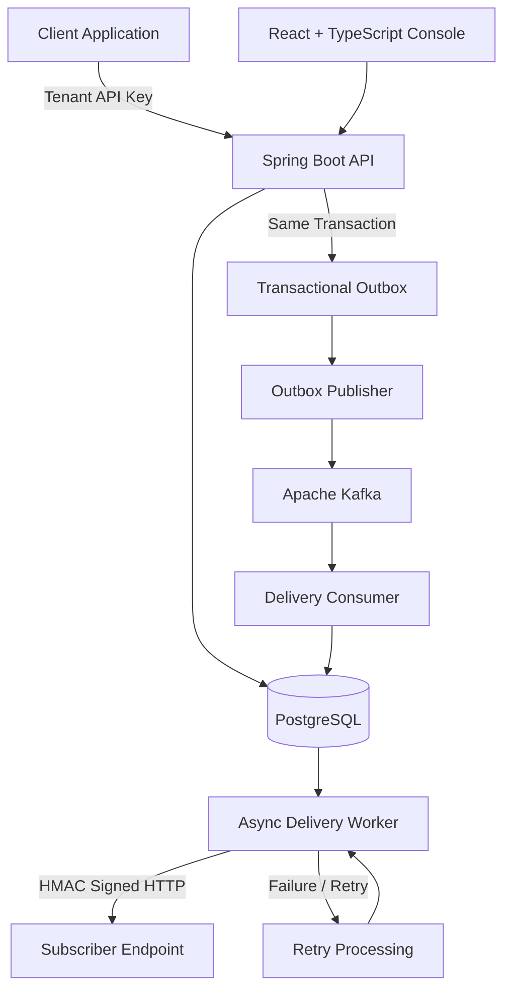

# HookForge

**A Multi-Tenant Webhook Delivery Infrastructure Built with Spring Boot, Kafka, and PostgreSQL.**

HookForge is a webhook delivery platform that enables applications to register events, subscribe endpoints, and receive reliable, cryptographically signed HTTP notifications.

It uses a **transactional outbox pattern, Kafka-based event routing, asynchronous delivery processing, and automated retries** to improve delivery reliability while maintaining tenant isolation.

## Key Features

- **Multi-Tenant Architecture:** Tenant-scoped APIs, endpoint management, event tracking, deliveries, and API-key authentication.
- **Transactional Outbox:** Persists application events and their corresponding outbox records within a single database transaction.
- **Event-Driven Processing:** Publishes outbox messages to Apache Kafka for asynchronous event distribution.
- **Reliable Delivery:** Creates endpoint-specific delivery records and processes HTTP notifications asynchronously.
- **Retry & Replay:** Supports retry handling and manual replay of previously recorded deliveries.
- **Request Signing:** Uses HMAC-based signatures to authenticate outgoing webhook payloads.
- **Encrypted Secrets:** Protects endpoint signing secrets using AES-GCM encryption.
- **Stateless Authentication:** Uses tenant-scoped API keys for backend authentication.
- **Developer Console:** React and TypeScript dashboard integrated with the live backend API.
- **Database Migrations:** Uses Flyway to manage PostgreSQL schema changes.

## Architecture



### Event Processing Flow

1. **Event Ingestion:** A tenant submits an application event through the REST API.
2. **Atomic Persistence:** The event and its outbox record are saved in the same PostgreSQL transaction.
3. **Event Publishing:** The outbox publisher forwards pending events to Kafka.
4. **Delivery Creation:** Kafka consumers identify active subscribed endpoints and create corresponding delivery records.
5. **Asynchronous Dispatch:** Delivery workers send HTTP POST requests containing the event payload.
6. **Request Verification:** Outgoing requests include HMAC-based signatures generated using encrypted endpoint secrets.
7. **Failure Handling:** Failed deliveries enter retry processing, with support for manual replay.

## Technology Stack

| Layer | Technologies |
|---|---|
| Backend | Java 21, Spring Boot |
| API | REST, Spring Security |
| Messaging | Apache Kafka |
| Database | PostgreSQL |
| Database Migrations | Flyway |
| Security | API Keys, AES-GCM, HMAC |
| Frontend | React, TypeScript |
| Infrastructure | Docker, Docker Compose |
| Testing | JUnit, Mockito, Testcontainers |

## Getting Started

### Prerequisites

- Java 21
- Node.js 22.12+
- Docker Desktop with Docker Compose
- PowerShell (for the commands below)

### 1. Clone the Repository

```powershell
git clone https://github.com/nisatsama/HookForge.git
cd HookForge
```

### 2. Configure Encryption

HookForge requires a 32-byte AES encryption key for endpoint secret protection.

Generate a key using PowerShell:

```powershell
$env:HOOKFORGE_ENCRYPTION_KEY = [Convert]::ToBase64String(
    [Security.Cryptography.RandomNumberGenerator]::GetBytes(32)
)
```

Keep this key secure and do not commit it to version control.

### 3. Start the Application

```powershell
docker compose -f infra/docker-compose.yml up --build
```

This starts the application using the repository's Docker Compose configuration.

### 4. Access the Console

Open:

```text
http://localhost:5173
```

**Initial Tenant Provisioning:** An initial API key must be provisioned through a trusted operator path. The repository currently does not provide a safe self-service bootstrap workflow. Tenant creation is also authenticated. Do not expose database access or introduce an unauthenticated public bootstrap endpoint to bypass this limitation.

For manual backend and frontend setup, environment configuration, and troubleshooting, refer to [Local Development Guide](docs/LOCAL_DEVELOPMENT.md).

## Verification

### Backend Tests

```powershell
cd backend

./mvnw clean test
./mvnw package
```

### Frontend Verification

```powershell
cd ../frontend

npm install
npm run build
npm run lint
npm run test
```

**Note:** Testcontainers integration tests require Docker to be available to the Java process.

## Documentation

| Document | Description |
|---|---|
| [Local Development](docs/LOCAL_DEVELOPMENT.md) | Environment configuration and local setup |
| [API Contract](docs/API_CONTRACT.md) | REST API endpoints and request/response contracts |
| [Backend Audit](docs/BACKEND_AUDIT.md) | Backend implementation review, limitations, and open risks |
| [Demo Deployment and Provisioning](docs/DEMO_DEPLOYMENT.md) | Safe demo tenant provisioning and deployment verification |

## Engineering Focus

HookForge explores practical backend engineering concepts, including:

- Reliable event processing and transactional consistency.
- Asynchronous communication using message brokers.
- Multi-tenant data isolation and authentication.
- Secure webhook signing and secret management.
- Retry mechanisms and failure recovery.
- Separation of event ingestion and delivery processing.

---

**Built with Java, Spring Boot, PostgreSQL, and Apache Kafka.**

## Public demo workspace

The public console opens a read-only Acme Commerce demo at `/`, with demo endpoints, events and delivery attempts. `/login` retains the existing API-key authentication flow. The demo uses a dedicated tenant marker and demo-only API; worker queries, outbox publishing, event routing and HTTP preparation exclude demo records. No demo API key is provisioned. See [Demo Deployment and Provisioning](docs/DEMO_DEPLOYMENT.md) for Render/Vercel configuration, the operator seed command, and verification steps.
